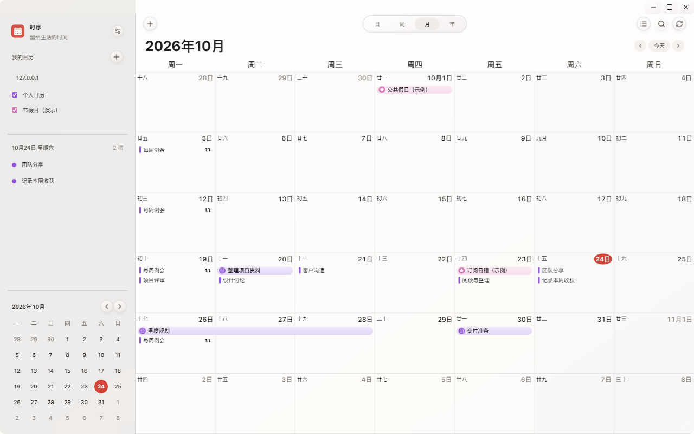
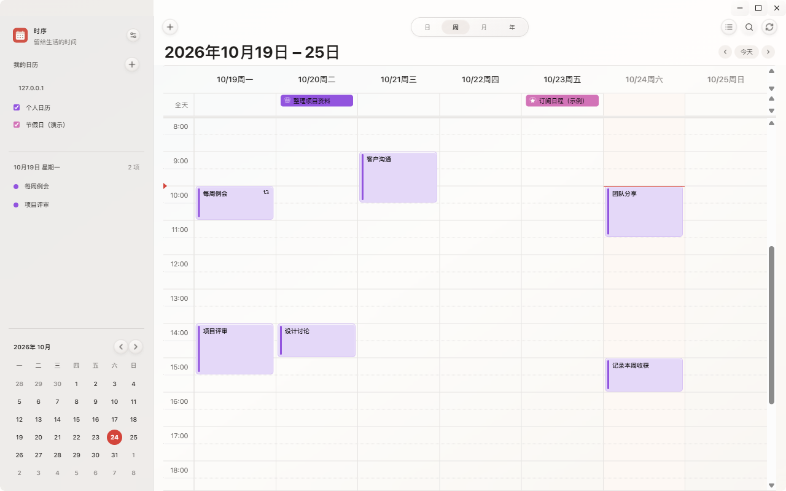
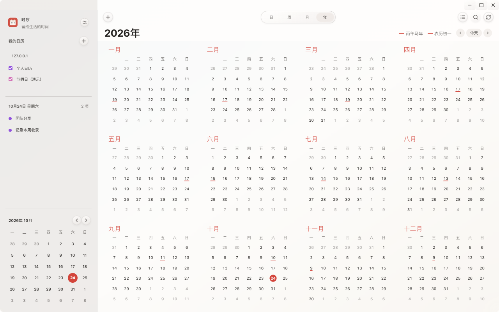
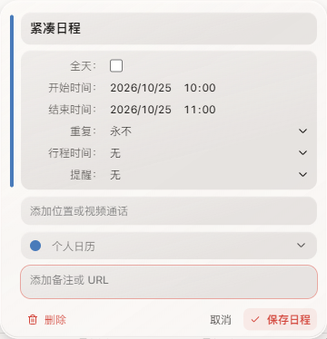
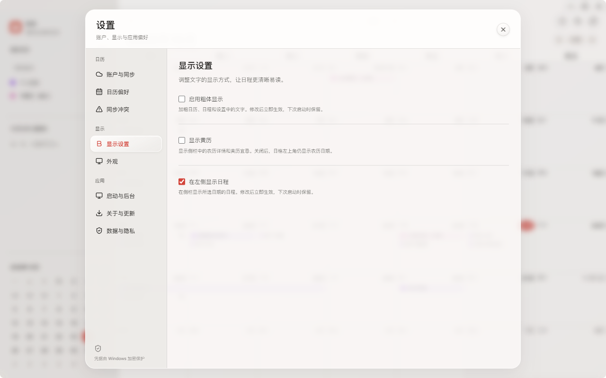
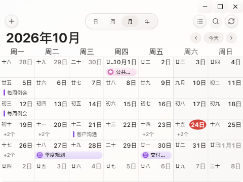

<p align="center"></p>

# 时序日历

面向 **Windows 10 / 11 x64** 的个人桌面日历。使用 **Tauri 2、Rust、React、TypeScript 和 SQLite**，支持 CalDAV 双向同步、ICS 链接订阅、离线编辑与 Windows 提醒。

当前正式版为 **2.2.2**，Windows 安装包约 **29.32 MiB**。界面采用液态玻璃风格，支持浅色、深色和跟随系统。

**[下载最新正式版](https://github.com/xiaomohaa/shixu-calendar/releases/latest)** · [直接下载 2.2.2 安装包](https://github.com/xiaomohaa/shixu-calendar/releases/download/v2.2.2/Shixu-Setup-2.2.2-x64.exe) · [2.2.2 更新说明](docs/RELEASE_NOTES_2.2.2.md)



> 本页截图从当前 Tauri 界面生成，使用独立的本地演示账户、演示日程与订阅；截图中的假日内容不作为实际放假安排。应用首次启动为空白日历，不附带这些数据。

## 当前功能

| 功能 | 当前行为 |
| --- | --- |
| 日、周、月、年与列表 | 顶部整体胶囊切换日/周/月/年，右侧列表图标打开日程列表 |
| 完整月历 | 固定七列六行，缩小窗口仍显示全部日期；按真实日格空间决定日程行数 |
| 日程折叠 | 放得下就继续显示；放不下时用独立的“+N个”入口查看全部，不转换为圆点，也不把数量压在胶囊上 |
| 全天与非全天 | 月视图全天使用胶囊、非全天使用短色条；日/周时间轴使用覆盖实际时长的填充时间块 |
| 跨天日程 | 连续胶囊跨越对应日期，跨周续接，折叠时避让数量入口 |
| 全年概览 | 四列三行显示十二个月，月份标题标红、农历初一加下划线，只标红今天 |
| 新建预览 | 双击日期弹出编辑浮层；未保存的标题、日期范围、全天状态会实时反映到日格 |
| 独立日期与时间 | 日期点击弹出小月历，时间单独设置；标题稍大于正文，设置集中在圆角框内 |
| 原位搜索 | 放大镜在顶部向左展开，邻近图标随动画移动；搜索当前日期范围的标题、地点与备注 |
| CalDAV | 账户发现、日历显隐与颜色、双向同步、手动/自动同步、取消同步与离线队列 |
| ICS 订阅 | 直接导入公开 `.ics` 链接，创建只读订阅，可手动或自动刷新 |
| 农历与黄历 | 左上角农历、右上角阳历；农历比阳历小 2px，侧栏黄历可独立关闭 |
| 显示偏好 | 粗体开关、侧栏日程开关；关闭侧栏日程时一起隐藏日期标题、数量与相关分隔线 |
| 统一时区 | 仅在设置中管理，默认 UTC+8 北京时间；日程编辑不再单独显示时区 |
| 可选悬浮通知 | 系统通知或 macOS 风格右上角悬浮通知；自适应高度、堆叠、悬停暂停、稍后提醒和打开日程 |
| 后台与更新 | 系统托盘、可选开机自启、静默启动、应用内检查与下载更新、显式重启安装 |

过去的日程保持完整颜色。全天普通日程显示圆形日历图标，节假日日历显示圆形星标；节假日根据日历名称或订阅来源识别。

## 安装与升级

1. 在 [Releases](https://github.com/xiaomohaa/shixu-calendar/releases/latest) 下载最新的 `Shixu-Setup-<版本>-x64.exe`。
2. 运行安装程序，按提示完成安装，通过创建的快捷方式启动。
3. 在侧栏右上角打开设置，添加 CalDAV 账户或导入 ICS 链接。

当前 Tauri 版本提供 Windows x64 安装包。安装后无需 Node.js、Rust 或开发服务器；应用使用 Microsoft WebView2 运行时，缺少运行时时按安装程序提示处理。应用暂无 Windows 代码签名，首次运行可能出现 SmartScreen 提示；更新文件另有独立的更新签名校验。

**Tauri 2.x 升级：** 设置 → 关于与更新 → 检查更新 → 下载 → 重启并安装。下载显示进度，支持取消和重试，通过签名校验后才允许安装；普通退出不会悄悄安装。也可以下载新安装包覆盖安装，保留本地数据和账户设置。

**Electron 1.x 迁移：** 手动安装当前 Tauri 版。首次创建 Tauri 数据库时会尝试复制旧数据库、迁移凭据，原数据库保留。旧版与 Tauri 数据目录相互独立，迁移后使用 Tauri 快捷方式继续操作。

## 界面预览

### 周视图与时间块

非全天事件按实际持续时间填充日历颜色，左侧保留色条，选中后加深。全天事件集中在时间轴上方。



### 全年概览

十二个月同页显示，不铺开日程胶囊。可切换年份、进入月份，或双击日期进入该月新建日程。



### 日程编辑

标题、日程设置、地点、所属日历和备注放在紧凑的液态玻璃浮层中，左侧竖条跟随日历颜色。标题和备注按内容自动伸缩，日期与时间分别操作，保留明确的保存、取消和删除。普通日程只删除当前记录；重复日程默认仅删除当前一次，也可选择“此日程及未来日程”或“整个重复系列”，删除未来日程会保留之前的历史。



### 设置与小窗口

设置按“日历、显示、应用”分组。侧栏随窗口宽度自动收放；窄窗口移到左边缘可唤出侧栏，设置入口位于侧栏右上角。





## 连接自己的日历

### CalDAV 账户

1. 打开设置 → 账户与同步 → 添加账户。
2. 填写账户名称、完整 HTTPS 服务地址、用户名和密码。地址可为服务根目录、calendar-home 或具体日历地址。
3. 点击“测试连接与自动发现”，查看实际发现的日历，再保存账户。
4. 默认每 10 分钟自动同步，也可点击工具栏同步按钮；同步中可以取消。
5. 在侧栏勾选要显示的日历，在设置中调整颜色、默认日历，或暂停账户同步。

iCloud 等服务可能需要应用专用密码。支持 HTTP Basic；明文 HTTP 必须在高级选项中主动开启。TLS 证书保持验证，自签名证书需先加入系统信任。当前没有 OAuth 登录窗口或交互式 Digest 登录。

### ICS 链接订阅

在设置 → 账户与同步中展开“通过 ICS 链接导入日历”，填写名称与公开链接，点击“导入 ICS 日历”。例如 iCloud 中国大陆节假日日历链接：

```text
https://calendars.icloud.com/holidays/cn_zh.ics/
```

导入后在侧栏显示，可以调整颜色、显隐、暂停与刷新。ICS 链接日历为只读，不能在本应用中向它新建或修改日程；要创建自己的日程，请同时配置一个可写的 CalDAV 日历。

**当前不再内置中国节假日及调休表。** 假日与补班内容由导入的日历提供，农历与黄历仍可离线显示。

## 日程操作

- 月格单击不选中、不改变背景；双击日期新建，点击已有日程打开编辑。
- 默认开始时间为所点击日期的当前小时整点，结束时间按“日历偏好”中的默认时长计算。例如当前 10:35、默认时长 60 分钟时，新建为该日期的 10:00–11:00。
- 空标题的草稿显示“新建日程”，输入后实时更新预览；取消或关闭会移除草稿，保存后才写入日历与同步队列。
- 全天日程的结束日期是**不包含的日期**，例如 23 日的一天日程，结束日期填写 24 日。
- 支持每天、每周、每月、每年及自定义 RRULE；重复事件区分“仅此一次”与“整个系列”。
- 支持地点、备注、提醒与手动行程时间。行程时间可以保存与重新读取，不自动估算路线，也不改变事件起止时间。
- 月视图可拖动已有日程调整日期；日/周视图可拖选新建、拖动改期或拉伸时长。
- 时区集中在设置 → 日历偏好 → 统一时区，默认 UTC+8；已有来源事件按该设置显示，编辑保存时保留实际时间和原始重复语义。

### 快捷键

| 快捷键 | 操作 |
| --- | --- |
| `N` | 新建日程 |
| `T` | 跳到今天 |
| `Ctrl+F` | 展开顶部原位搜索 |
| `Ctrl+,` | 打开显示设置 |
| `Escape` | 收起搜索或关闭当前浮层；日期月历打开时先关闭月历 |

## 后台运行与提醒

默认关闭窗口会收纳到系统托盘，后台同步与提醒继续运行。点击托盘图标或再次启动应用可打开主窗口；托盘菜单或设置中的“退出时序日历”会彻底退出。

在设置 → 启动与后台中，可以分别控制：

- **开机自启**：登录 Windows 后启动到托盘，默认关闭。
- **静默启动**：手动启动时也不弹出主窗口，下次启动生效，默认关闭。
- **关闭窗口后收纳到系统托盘**：关闭后是否继续在后台运行。

本地提醒使用 Windows 通知，要求应用保持运行；彻底退出后不会提醒。系统通知权限与专注助手可能影响通知显示。

### macOS 风格悬浮日程通知

在 **设置 → 启动与后台 → 日程通知** 中选择：

- **系统通知**：继续使用 Windows 原生通知，是旧设置的默认方式。
- **macOS 风格悬浮通知**：透明、置顶、右上角堆叠，不抢占焦点；卡片高度跟随内容，支持浅深主题。

点击“测试通知”可测试当前方式。悬浮通知显示约10秒，悬停时暂停；“稍后提醒”会在10分钟后再次提醒，并持久化到 SQLite，重启后继续处理。“打开日程”会唤出主窗口并定位事件；日程改期后读取最新内容，未保存编辑会先确认。

通知窗口固定贴主显示器可用区域右上边缘，文字加粗，按任务栏和 DPI 定位，最多同时显示三条，其余进入队列。卡片之间的可见间距约8px；关闭后立即触发平滑上移补位，不再等待后台定时检查。应用须保持运行；退出期间不会弹窗，恢复后处理已到期的稍后提醒。当前硬件已验证单显示器200% DPI，多显示器与其他缩放的测试范围见[通知设计与验证](docs/NOTIFICATION_DESIGN.md)。


## 数据与隐私

Rust 原生后台处理网络、SQLite 和 Windows 凭据保护，React 界面通过受限的 Tauri 命令调用。密码使用 Windows DPAPI 加密后保存，不回传界面；日程缓存本身为普通 SQLite 数据。无遥测、无广告。

- Tauri 正式版数据通常位于 `%APPDATA%\cn.shixu.calendar.tauri`，数据库为 `calendar.db`。
- Electron 历史数据通常位于 `%APPDATA%\时序日历`，首次迁移会复制，不会删除原库。
- 离线创建、修改和删除先保存在本地，下次同步继续提交。
- 使用 ETag 条件写入保护远程版本；遇到冲突可采用服务器、本地版本，或保留双方。
- 删除账户只清理本地关联数据，不删除服务器上的日历；会同时清除该账户的本地未同步修改。
- 设置备份只包含偏好，不包含密码、账户或日程，不能代替完整数据备份。

## 当前边界

- 当前正式发布面向 Windows 10/11 x64，未提供 macOS、Linux 或 ARM64 安装包。
- 未实现会议邀请、参与者回复、共享权限管理或远程新建/删除日历。
- 复杂重复系列的整体锚点与规则修改有保护限制；范围例外和部分复杂资源需在原服务编辑，原始数据会保留。
- 常见 DISPLAY 提前提醒可在本机触发；复杂提醒保留在 ICS 中，但不保证本机执行。
- 已有本地真实 HTTP DAV、ICS 订阅和桌面端到端回归，不代表已逐一认证所有 CalDAV 服务商。

## 开发与验证

### Windows 构建环境

- Node.js 24 x64 与 npm，依赖按 `package-lock.json` 安装。
- Rust stable，最低版本以 `src-tauri/Cargo.toml` 为准，当前为 1.90。
- Visual Studio Build Tools 的“使用 C++ 的桌面开发”组件，包含 MSVC x64 和 Windows SDK。可以使用 VS Code 编辑源码，无需安装完整 Visual Studio IDE。
- Microsoft WebView2 运行时。

正式版版本号以 [`src-tauri/tauri.release.conf.json`](src-tauri/tauri.release.conf.json) 为准。根 `package.json` 的 `1.3.0` 和 Rust 基础开发版本保留历史含义，不代表当前正式版。

```powershell
# 仅开发 Tauri 时，可以跳过历史 Electron 二进制的下载
$env:ELECTRON_SKIP_BINARY_DOWNLOAD = '1'
npm ci

npm run typecheck
npm test
cargo test --manifest-path src-tauri/Cargo.toml --lib

# 构建独立标识的 UI 开发预览，不生成安装包
npx tauri build --config src-tauri/tauri.ui-preview.conf.json --no-bundle
& '.\src-tauri\target\release\shixu-calendar.exe'
```

开发预览使用独立的 `.dev` 应用标识，与正式数据目录分开。上述流程使用静态前端，修改后重新构建即可。根目录的 `npm run dev`、`npm start`、`pack` 等保留脚本属于历史 Electron 流程，不用于当前 Tauri 正式版分发。

### 桌面回归

先构建上面的 **UI 开发预览**，再按需运行：

```powershell
npm run test:tauri-account     # CalDAV、ICS、创建修改、草稿与跨天显示
npm run test:tauri-desktop     # 原生窗口、托盘、侧栏、字体与年视图
npm run test:tauri-polish      # 编辑器、日期选择、统一时区与明暗主题
npm run test:tauri-editor      # 自适应弹窗、单次/未来/系列删除及同步
npm run test:tauri-capacity    # 多窗口尺寸的真实日格容量与数量折叠
npm run test:tauri-notification # 焦点、DPI、堆叠、后台触发、稍后提醒与重启恢复
npm run test:tauri-silent      # 静默启动与唤出
npm run test:tauri-migration   # Electron 数据迁移
npm run test:tauri-background  # 隐藏窗口后的同步与提醒
```

这些测试会打开实际 WebView2 窗口，使用 `.smoke-data/` 内的独立数据。测试目录覆盖只对开发标识生效，运行前须确认二进制为开发预览；正式构建后应重新构建开发预览再运行桌面测试。

### 正式构建与更新文件

维护者需要使用与已发布版本匹配的更新签名密钥。私钥不在仓库中，不要提交私钥或重置已有用户信任的更新公钥。

```powershell
# 在正式构建覆盖输出前，保留隔离预览供更新测试使用
New-Item -ItemType Directory -Force '.smoke-data' | Out-Null
Copy-Item 'src-tauri/target/release/shixu-calendar.exe' '.smoke-data/shixu-calendar-ui-preview.exe'

$env:TAURI_SIGNING_PRIVATE_KEY = 'C:\secure\shixu-update.key'
npm run tauri:release
npm run tauri:prepare-release

# 使用隔离预览校验正式安装包的下载与签名，不直接运行正式数据目录
$env:SHIXU_TAURI_TEST_EXE = (Resolve-Path '.smoke-data/shixu-calendar-ui-preview.exe').Path
npm run test:tauri-updater
```

原始 NSIS 包位于 `src-tauri/target/release/bundle/nsis/`；整理后的发布文件位于 `release-tauri/`。每次发布须一并上传：

- `Shixu-Setup-<版本>-x64.exe`
- `Shixu-Setup-<版本>-x64.exe.sig`
- `latest.json`
- `SHA256SUMS.txt`

更新正式版本配置和对应发布说明后构建、验证、提交并推送版本标签，再上传文件并设为最新正式发布。不要将开发预览标为正式版，也不要只上传 EXE。

### 重拍 README 截图

```powershell
$env:SHIXU_TAURI_TEST_EXE = (Resolve-Path '.smoke-data/shixu-calendar-ui-preview.exe').Path
node scripts/capture-readme.mjs
```

脚本使用独立本地演示账户与数据目录，生成本页六张截图，不读取真实账户。运行时应使用与当前正式界面一致的开发预览二进制。

## 源码与文档

```text
src-tauri/
  src/          Rust 窗口、托盘、DAV、ICS 订阅、SQLite、DPAPI 与更新
  capabilities/ Tauri 权限
  tests/        更新签名等原生验证
src/
  renderer/     React 视图、编辑器、设置与玻璃主题
  calendar/     日期布局、容量、农历、草稿与图标规则
  platform/     Tauri 调用与 Worker 适配
  workers/      ICS 展开与编辑 Worker
  ical/         ICS 编辑、重复实例与时区定义
  shared/       类型契约与校验
  main/         保留的 Electron 服务与协议测试基线
  database/     保留的 TypeScript 存储与测试基线
scripts/        构建、桌面回归、更新校验与文档截图
build/          应用 Logo 与安装器图标
fonts/          字体素材与说明
docs/           发布说明、截图与历史记录
```

当前版本变化见 [2.2.2 发布说明](docs/RELEASE_NOTES_2.2.2.md) 和 [全部正式发布](https://github.com/xiaomohaa/shixu-calendar/releases)。

旧版使用与构建说明保存在 [Electron 1.3.0 历史归档](docs/archive/README_ELECTRON_1.3.0.md)。迁移计划、早期设计及验收记录仅作为历史资料，不代表当前界面或发布状态。

项目代码采用 [MIT 许可](LICENSE)。字体素材与第三方依赖的权利单独说明，见 [字体说明](fonts/NOTICE.md) 与 [第三方许可](THIRD_PARTY_NOTICES.md)。
