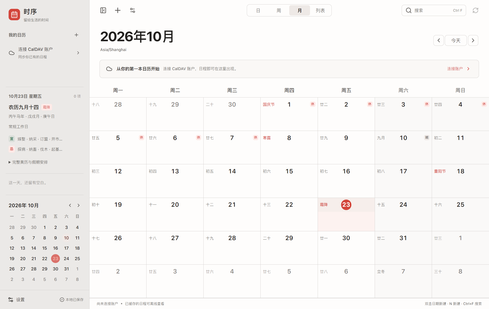
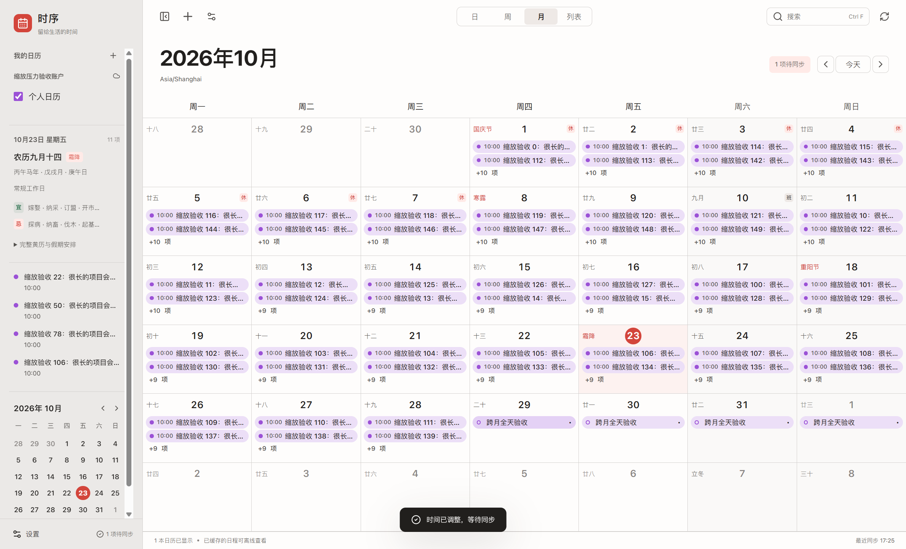
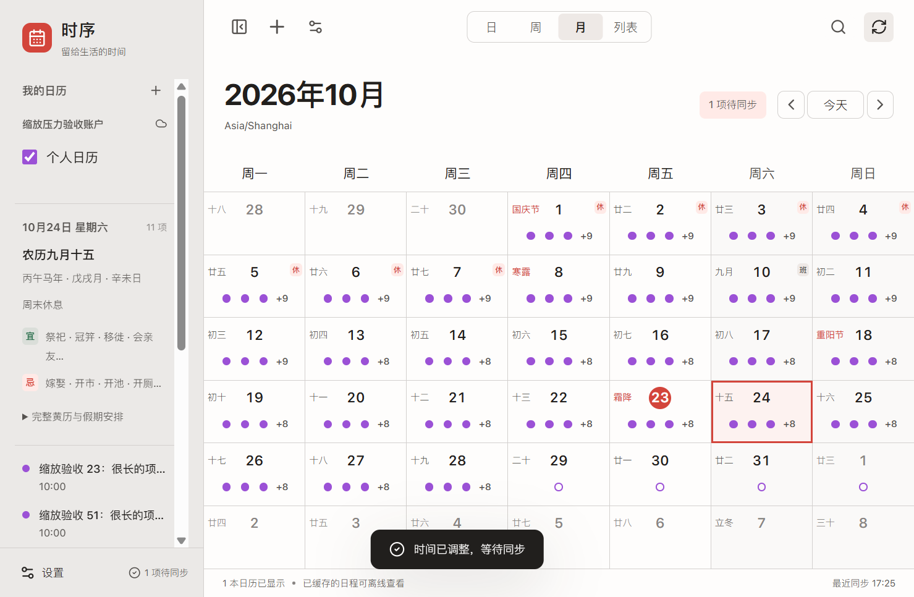

# 时序日历

当前正式版使用 **Tauri 2 + Rust + React**。下载 [Windows x64 安装包](https://github.com/xiaomohaa/shixu-calendar/releases/latest)。现有 Tauri 2.x 用户可在“设置 → 关于与更新”中升级；Electron 1.x 用户请手动安装 Tauri 版本。旧版数据会复制迁移，原数据库保留。

2.0.5 按参考图重做四列三行全年概览，标记农历初一；侧栏只保留服务分组与勾选日历，日/周/月/年改为整体胶囊。新建日程在日格中实时预览标题、全天状态和日期范围，保存前不会写入日历；日程高度降至 16px。保留静默启动与双击日格的新建浮层。完整变化见 [2.0.5 发布说明](docs/RELEASE_NOTES_2.0.5.md)。

下面保留 Electron 1.3.0 的历史开发与打包说明。Tauri 的构建命令见 [迁移计划](docs/TAURI_MIGRATION_PLAN.md) 和 package.json 中的 `tauri:*` 脚本。

> 历史接续开发记录：[Tauri 2 迁移计划](docs/TAURI_MIGRATION_PLAN.md)。`edit` 分支当前保存计划，程序仍为 Electron 1.3.0，原生迁移尚未实施。

运行于 **Windows 10/11 x64** 的个人 CalDAV 客户端。Electron + React + TypeScript + Vite；中文界面，支持浅色、深色与系统主题。首次运行没有示例账户或演示日程。



## 安装和启动

[下载最新 Windows x64 安装包或便携版](https://github.com/xiaomohaa/shixu-calendar/releases/latest)。

在 `release` 中选择：

- `Shixu-Setup-1.3.0-x64.exe`：安装程序，可选择安装路径并创建桌面快捷方式，支持应用内升级与可选开机自启。
- `Shixu-Portable-1.3.0-x64.exe`：免安装启动器。**便携版的数据仍存于当前 Windows 用户的应用数据目录，不随 EXE 移动**。
- `win-unpacked/时序日历.exe`：解压版入口，需要保留同目录全部文件。

安装后无需 Node.js 或 Vite。应用尚未签名，Windows 可能显示 SmartScreen 提示。程序采用用户级安装，不需要管理员权限。当前未对每个 Windows 10/11 版本分别测试。

通过“时序日历”快捷方式打开，或运行安装目录内的“时序日历.exe”。`node_modules/electron/dist/electron.exe` 是开发运行时，直接点击且不带项目参数会出现 Electron 默认页面，不是日历的独立入口。

### 后台运行与开机自启

默认点击关闭按钮会收纳到 Windows 右下角系统托盘，同步与提醒继续运行。点击托盘图标可恢复；右键选择“退出时序日历”或在设置中退出，才会停止应用。托盘图标可能位于系统隐藏图标箭头中。“设置 → 启动与后台”可关闭收纳行为，也可启用“开机自启”：登录 Windows 后启动到托盘，默认不启用。仅安装版提供自启，使用实际安装路径；系统禁用启动项时会提示。

### 内置更新

“设置 → 关于与更新”显示真实版本、更新内容和检查时间。默认启动后及每 6 小时检查本仓库的 GitHub 正式发布，可关闭自动检查。发现版本后手动下载，显示进度，可取消和重试；文件完整性校验成功后点击“重启并安装”。选择稍后时，正常退出也不会偷偷安装。安装前停止同步并安全关闭数据库，账户、凭据、离线修改与设置继续保留。

**1.1.0 及更早版本没有更新器，需手动安装当前版本一次**，以后可在软件内更新。便携/解压版可检查新版本，但需通过发布页面下载并退出后替换应用文件。开发模式不执行更新。网络或校验失败时可以重试，也保留手动下载入口。

英文和数字使用内置 SF Pro（San Francisco），中文使用内置苹方，不依赖 Windows 系统字体安装。用户提供的原始素材保存在 [fonts](fonts/NOTICE.md)，相关权利与项目代码许可分开说明。

## 配置自己的 CalDAV

1. 打开“设置 → 账户与同步 → 添加账户”。
2. 输入账户名称、完整 HTTPS 服务地址、用户名和密码。地址可为服务根目录、calendar-home 或具体日历地址，无服务商绑定。
3. 点击“测试连接与自动发现”。成功时显示真实发现的日历；认证或 HTTP 错误会显示中文说明和状态码。
4. 点击“保存账户”。保存后启动首次同步。默认每 10 分钟自动同步，也可使用工具栏同步按钮；同步中再次点击可取消。
5. 在侧栏选择要显示的日历；设置中可改变颜色和默认日历，暂停账户或删除本地账户。

iCloud 等服务通常需要应用专用密码。若根地址发现失败，请使用服务商提供的具体 CalDAV 地址。发现会读取 current-user-principal、calendar-home-set、resourcetype、组件类型和可用权限，并尝试 `/.well-known/caldav`。跨站点重定向不会自动携带密码；若服务器将账户重定向到另一个域名，请使用该目标站点的具体服务地址重新配置。

支持 HTTP Basic。HTTP 明文传输必须在高级选项中主动勾选。TLS 始终验证；自签名服务器应先将证书安装到受信任证书链，应用不提供忽略证书选项。暂不支持 OAuth 登录窗口、交互式 Digest 或代理单独认证。

## 使用

- 月、周、日、列表视图可切换；周/日视图支持拖选新建、拖动和拉伸调整时间，重叠事件由 FullCalendar 排列。
- 点击日期在侧栏查看当天安排；双击空白日期或按 `N` 新建。`T` 跳到今天，`Ctrl+F` 搜索当前显示日期范围的标题、地点和备注。
- 编辑器支持标题、日期时间、全天、日历、地点、备注、重复规则及提醒。全天事件的结束日期为**不包含的日期**，例如 23 日的全天日程应填写结束于 24 日。
- 支持每日/周/月/年和自定义 RRULE；重复日程明确区分“仅此一次”和“整个系列”。单次修改使用 RECURRENCE-ID，单次删除使用 EXDATE。
- 本地保存立即持久化；标记为待同步并在下一次自动或手动同步时提交。离线修改、删除和冲突可在退出后保留。
- 冲突在“设置 → 同步冲突”查看，支持采用服务器、本地版本或另存副本保留双方。选择本地版本仍通过最新 ETag 条件写入。
- 设置中的同步间隔、默认视图、每周首日、默认时长、提醒、时区、日期/时间格式、主题等均持久化生效。
- 月视图日期与农历信息居中显示，包含闰月、节气和传统节日。点击日期在侧栏查看农历、生肖干支、黄历宜忌，展开可看冲煞、值神、财神喜神方位及彭祖百忌。
- 中国大陆节假日以“休”标注，调休补班以“班”标注，点击可看假期及补班日期。目前离线核对收录 2024–2026 年官方安排；未收录年份不猜测放假和补班日期。农历、黄历和节假日显示均不依赖账户和网络，也不会创建远程日程。数据来源见[历法说明](docs/CHINESE_CALENDAR.md)。

## 月视图与缩放

新版按 macOS 日历参考调整主界面：灰色侧栏、大号深色年月标题、更清楚的正文与辅助文字。日期居中、农历黄历和休班信息保留，天气暂未加入。

月视图固定七列六行。空间足够时用日历颜色的浅色胶囊展示日程，长标题省略；缩小时自动改为可点击的彩色点。+N 可展开当天全部日程并查看完整标题、时间和地点，也可继续编辑或新建。日期范围和缓存不会因纯缩放反复读取。大幅缩放时自动收起侧栏，日历内部可滚动查看；顶部按钮可再次展开侧栏。





支持双击空白日期新建、跨日拖选全天日程和拖动调整日期。跨月事件会在覆盖的每个日格显示；拖动按起点日格计算历日差，保留时长。周、日和列表视图继续可用。验证用 321 个实际 DAV 日程覆盖 67%–200% 页面缩放与连续 48 次尺寸变化，详见[设计与测试边界](docs/MONTH_UI_DESIGN.md)。

## 数据完整性与限制

- 使用 `PROPFIND`、`REPORT`、`sync-collection`、`calendar-query`、`calendar-multiget`、`PUT` 和 `DELETE`。有效 sync-token 优先；服务器不支持或令牌过期时回退全量查询。每账户只有一个同步任务，请求超时 25 秒，取消后保留队列，下次同步重试。
- 原始 ICS、远程资源 URL 和 ETag 保存在 SQLite。新建使用固定资源 URL 与 `If-None-Match: *`，更新和删除使用 `If-Match`，412 保留双方版本。服务器没有 ETag 时不进行无条件覆盖，交由冲突处理。
- 编辑使用 ical.js 完整组件树，保留未知属性、VTIMEZONE、参与者和未主动更改的提醒。支持 RRULE、RDATE、EXDATE、RECURRENCE-ID、DURATION、UTC 和浮动时间。
- 含复杂重复例外时，不允许改变规则或平移整个系列的 DTSTART；含 RANGE=THISANDFUTURE 的系列不在本应用修改/删除单次实例；多个独立 VEVENT 共用资源或孤立例外需要在原服务编辑。这些限制会明确报错并保留数据。
- 新建事件支持 1901–2099 年。新写入的 IANA 时区定义由 Electron ICU 生成，覆盖 1900–2100 年；远程定义优先保留。密集重复的展开限制为 100000 次迭代，超过时提示且不改写原数据。单次 DAV 响应上限 32MB；尚未实现 sync-collection 分页。
- 读取常见 DISPLAY 提前提醒，并通过 Windows 通知提醒，**仅在应用运行时生效**。收纳到托盘后继续提醒，彻底退出后不工作；系统通知权限、专注助手可能影响显示。复杂、绝对时间、EMAIL/AUDIO、多重或 RELATED=END 提醒会保留，但当前不在本机触发。
- 未实现会议邀请、参与者回复、共享日历权限编辑、远程新建/删除日历或 CalDAV scheduling。
- 当前已用真实本机 HTTP DAV 服务进行协议和 Electron 端到端测试。**未使用真实 Nextcloud、iCloud、Radicale、Baïkal 账户逐一验证**；不能将此测试视为所有服务商兼容性认证。

## 隐私

网络、数据库和凭据只在主进程处理。渲染进程开启 contextIsolation 与 sandbox，禁用 Node.js，IPC 校验来源、方法及参数。CSP 禁止远程脚本、对象和任意导航，无遥测。

密码由 Electron 45 的异步 safeStorage 使用 Windows DPAPI 保护；普通数据库只保存密文，不回传渲染进程。日程缓存本身是普通 SQLite，建议保护 Windows 账户并启用磁盘加密。删除账户需要确认，只删除本地关联数据，包含未同步操作，不删除远程资源。清缓存保护未同步变更及冲突。

默认数据目录可通过 Electron 的 `app.getPath('userData')` 确定，通常位于 `%APPDATA%/时序日历`。测试通过 `SHIXU_DATA_DIR` 使用独立目录。设置备份只包含偏好，不包含密码、账户或日程；更换电脑后需重新添加账户。

## 开发环境与命令

建议 Node.js 24 x64、npm 11 或更新版本。依赖版本锁在 package-lock.json，无需本机 C++ 编译器。SQLite 使用 Electron 携带的 `node:sqlite`。

```powershell
npm ci
# 若安装策略跳过 Electron 下载，则执行：
node node_modules/electron/install.js

npm run dev         # 构建主进程，启动 Vite 和 Electron；改主进程后需重新启动
npm run typecheck   # 严格 TypeScript
npm test            # Vitest 协议、ICS、SQLite、同步集成
npm run build       # 静态渲染资源 + 主进程 / preload bundle
npm start           # 启动本地生产构建
npm run smoke       # 真实 Electron + 独立本机 DAV 服务；会打开测试窗口
npm run test:resize  # 密集日程、缩放压力、拖动与详情（独立测试数据）
npm run test:updater # 真实 Electron HTTP 更新下载、完整性校验和取消重试
npm run pack        # 生产构建并生成 Windows x64 安装版、便携版
npm run pack:dir    # 仅生成可运行解压目录
npm run release:publish # 检验标签与元数据，先上传 draft 的全部更新文件再公开
```

首次下载需要访问 npm、Electron 发布源和 electron-builder 工具下载源。生产启动不需要开发服务器。图标已随源码提供；需要重绘时可用 Pillow 执行 `python scripts/make-icon.py`。

发布时必须一并上传 Setup、Portable、Setup.exe.blockmap、latest.yml 和 SHA256SUMS.txt。`release:publish` 要求工作区已提交、`v<版本>` 标签指向 HEAD 且已推送远端；运行于已授权的 gh 登录环境。不要只上传 EXE，否则应用无法检查并获取更新。新版本先更新 package.json 和 lockfile，写发布说明，再构建、验证、提交、打标签和发布。详见 [更新设计](docs/UPDATE_DESIGN.md)。

## 目录

```text
src/
  main/        窗口、安全 IPC、应用服务、本地提醒
  preload/     只暴露白名单 API
  renderer/    React 主窗口、编辑器、设置和主题
  calendar/    离线农历黄历、节气节日、官方放假与调休表
  caldav/      受控网络、发现、DAV XML 和同步引擎
  ical/        完整 ICS 修改、重复实例、时区定义
  database/    SQLite 实体、迁移、事务、操作队列
  security/    凭据加解密抽象
  shared/      类型契约、Zod 校验、错误和脱敏
tests/         可控 DAV 服务器、单元与集成测试
scripts/       开发/构建、图标生成、Electron 冒烟
docs/          设计和验证记录
build/         应用图标
release/       安装包、便携版和解压版
```

详见 [验证记录](docs/VALIDATION.md) 与 [第三方许可](THIRD_PARTY_NOTICES.md)。
